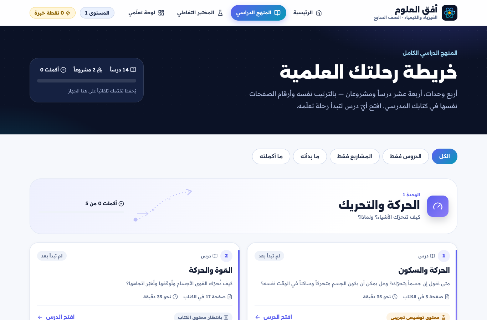
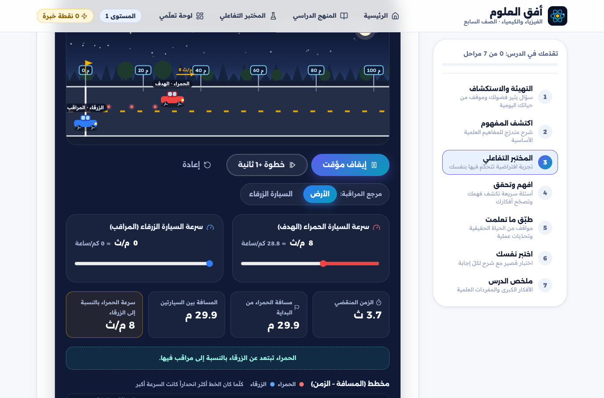
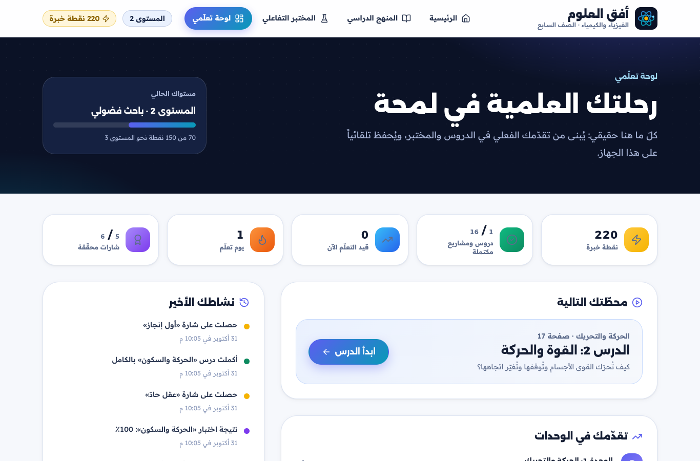

# أفق العلوم | الفيزياء والكيمياء — الصف السابع

منصّة تعلّم تفاعلية باللغة العربية (RTL بالكامل) لطلاب الصف السابع، تحوّل مفاهيم الفيزياء والكيمياء إلى تجارب حيّة داخل مختبر افتراضي.

**فلسفة التعلّم:** اكتشف ← استكشف ← جرّب ← افهم ← طبّق ← أتقن

> ⚠️ **ملاحظة جوهرية حول المحتوى:** المصدر الوحيد المتوفر من الكتاب المدرسي حتى الآن هو **فهرس المحتويات**، وقد نُقلت منه بنية المنهج (الدروس والمشاريع وأرقام الصفحات) بدقّة كاملة. أما الشروح والأنشطة فهي موادّ **توضيحية إضافية** سليمة علمياً وموسومة بوضوح داخل المنصة، بانتظار مطابقتها مع صفحات الكتاب الرسمي. لا تدّعي المنصة أن أيّ محتوى حالي منقول حرفياً من الكتاب.

---

## لقطات من المنصة

| الرئيسية | مستكشف المنهج |
|---|---|
|  |  |
| **بيئة الدرس (7 مراحل)** | **المختبر التفاعلي: الحركة والسكون** |
|  |  |
| **لوحة التعلّم بعد إكمال الدرس الأول** | **على الهاتف** |
|  |  |

---

## ما الذي تعمل فعلاً في هذه النسخة؟

- **بنية منهج موثقة:** 4 وحدات، 14 درساً ومشروعان — بالأسماء وأرقام الصفحات نفسها في فهرس الكتاب، مع تمييز واضح بين الدرس والمشروع.
- **درس أول كامل (توضيحي):** «الحركة والسكون» بجميع المراحل السبع: التهيئة والاستكشاف ← اكتشف المفهوم ← المختبر التفاعلي ← افهم وتحقق (تغذية راجعة فورية تعالج الفهم الخاطئ) ← طبّق ما تعلمت ← اختبر نفسك (نتيجة وشرح لكل سؤال) ← ملخص الدرس.
- **مختبر حركة حقيقي:** سيارتان بسرعات قابلة للضبط، تبديل مرجع المراقبة (الأرض / سيارة متحركة)، نقاط مواضع لحظية، مخطط (المسافة–الزمن) حيّ، تحدّي تنبّؤ بالموضع، و4 مهام مختبرية تُنجز بالتجريب الفعلي.
- **تحفيز هادف:** نقاط خبرة لا تُمنح إلا مقابل تعلّم حقيقي (إكمال مراحل، اجتياز اختبارات، إنجاز مهام مختبر) وبلا إمكانية تكرار لجمع النقاط + مستويات وشارات وسلسلة أيام تعلّم وسجل نشاط حقيقي — كلها محفوظة محلياً (`localStorage`).
- **15 درساً ومشروعاً بانتظار الكتاب:** صفحات صادقة توضّح حالة المحتوى وما سيضمه كل درس.
- **منطقة معلّم تأسيسية:** خطة القدرات + جرد حيّ لحالة محتوى المنصة (موسومة صراحة بأنها غير محمية بعد — لا حسابات بعد).
- **تجربة عربية كاملة:** RTL منضبط بخصائص CSS المنطقية، خطوط عربية مدمجة (Alexandria + Readex Pro)، تصميم متجاوب (هاتف/لوحي/حاسوب)، احترام `prefers-reduced-motion`، تنقّل بلوحة المفاتيح، وتباين لوني مدروس.

## البنية التقنية

| الطبقة | الاختيار | السبب |
|---|---|---|
| الواجهة | React 18 + TypeScript (strict) | مكوّنات قابلة لإعادة الاستخدام وسلامة أنواع |
| البناء | Vite 5 | سرعة تطوير وبناء ثابت بسيط النشر |
| التوجيه | React Router (HashRouter) | يعمل على أي استضافة ثابتة دون إعادة كتابة خادم |
| التصميم | CSS مخصص بنظام Tokens | هوية بصرية خاصة وتحكّم كامل بـ RTL |
| الحالة | Context + Reducer + localStorage | بلا خادم في هذه المرحلة، منطق صرف قابل للاختبار |
| الأيقونات | Lucide | اتساق واحترافية |
| الاختبار | Vitest + Testing Library | 35 اختباراً آلياً + تحقق متصفح حقيقي |

### هيكل المشروع

```
src/
├─ data/
│  ├─ curriculum.ts        ← بنية المنهج الموثقة (الفهرس) — لا تُعدَّل دون إذن
│  ├─ badges.ts            ← تعريفات الشارات
│  └─ lessons/             ← محتوى الدروس (ملف لكل درس) + سجلّ التسجيل
├─ types/content.ts        ← نظام أنواع المحتوى (الفصل بين البنية والمحتوى)
├─ state/progress.tsx      ← التقدّم: XP idempotent، شارات، سلاسل، حفظ محلي
├─ lib/motion.ts           ← فيزياء الحركة الصرفة (وحدات مختبر قابلة للاختبار)
├─ components/
│  ├─ layout/  ui/  curriculum/  lesson/  lab/
├─ pages/                  ← Home, Curriculum, LessonPage, LabPage, Dashboard, TeacherPage
└─ styles/                 ← tokens.css + base.css
```

## تشغيل المشروع

```bash
npm install
npm run dev        # خادم التطوير
npm run build      # بناء الإنتاج (typecheck + vite build) → dist/
npm test           # الاختبارات الآلية (35 اختباراً)
npm run lint       # فحص الأسلوب
npm run typecheck  # فحص الأنواع
```

يعمل GitHub Actions (`.github/workflows/ci.yml`) على كل طلب سحب موجّه إلى `main`: lint ← typecheck ← test ← build.

**النشر:** مجلد `dist/` ثابت بالكامل بمسارات نسبية (`base: './'`) — يُنشر كما هو على GitHub Pages أو أي استضافة ثابتة، بما فيها المسارات الفرعية.

## نظام المحتوى وكيفية إضافة دروس الكتاب

المحتوى منفصل تماماً عن العرض. لكل عنصر في المنهج حالة تحريرية تظهر للطالب بوسم واضح:

- `textbook-verified` — مُتحقَّق من الكتاب
- `demo-supplementary` — توضيحي تجريبي (حالة الدرس الأول حالياً)
- `pending` — بانتظار محتوى الكتاب

**لإضافة درس جديد عند توفّر صفحاته:**

1. أنشئ ملفاً في `src/data/lessons/` يصدّر كائن `LessonContent` (انسخ بنية الدرس الأول: تهيئة، اكتشاف بكتل محتوى م typed، أسئلة تحقق واختبار مع شروح ومعالجة فهم خاطئ، تطبيقات، ملخص ومفردات).
2. سجّله في `src/data/lessons/index.ts`.
3. حدّث `contentStatus` للعنصر في `src/data/curriculum.ts` إلى `textbook-verified` بعد المطابقة.
4. اختيارياً: سجّل مختبراً تفاعلياً جديداً في `src/components/lab/registry.tsx` واربطه عبر `labId`.

لا حاجة لتعديل أي مكوّن عرض: بيئة الدرس ذات المراحل السبع تبني نفسها من البيانات.

## قيود معروفة وخطوات تالية مقترحة

- المحتوى التعليمي الكامل متوفر للدرس الأول كنسخة توضيحية؛ بقية الدروس تنتظر صفحات الكتاب للمطابقة قبل كتابة شروحها.
- لا حسابات ولا خادم خلفي: التقدم محلي لكل جهاز. منطقة المعلم تأسيسية وغير محمية.
- مختبر تفاعلي واحد حالياً (الحركة)؛ إطار التسجيل جاهز لمختبرات الضغط والحرارة والأمواج.
- خطوات تالية طبيعية: مطابقة محتوى الكتاب درساً درساً، حسابات طلاب ومعلّمين مع صلاحيات، مختبرات الوحدات المتبقية، تقارير فهم خاطئ للمعلّم.
